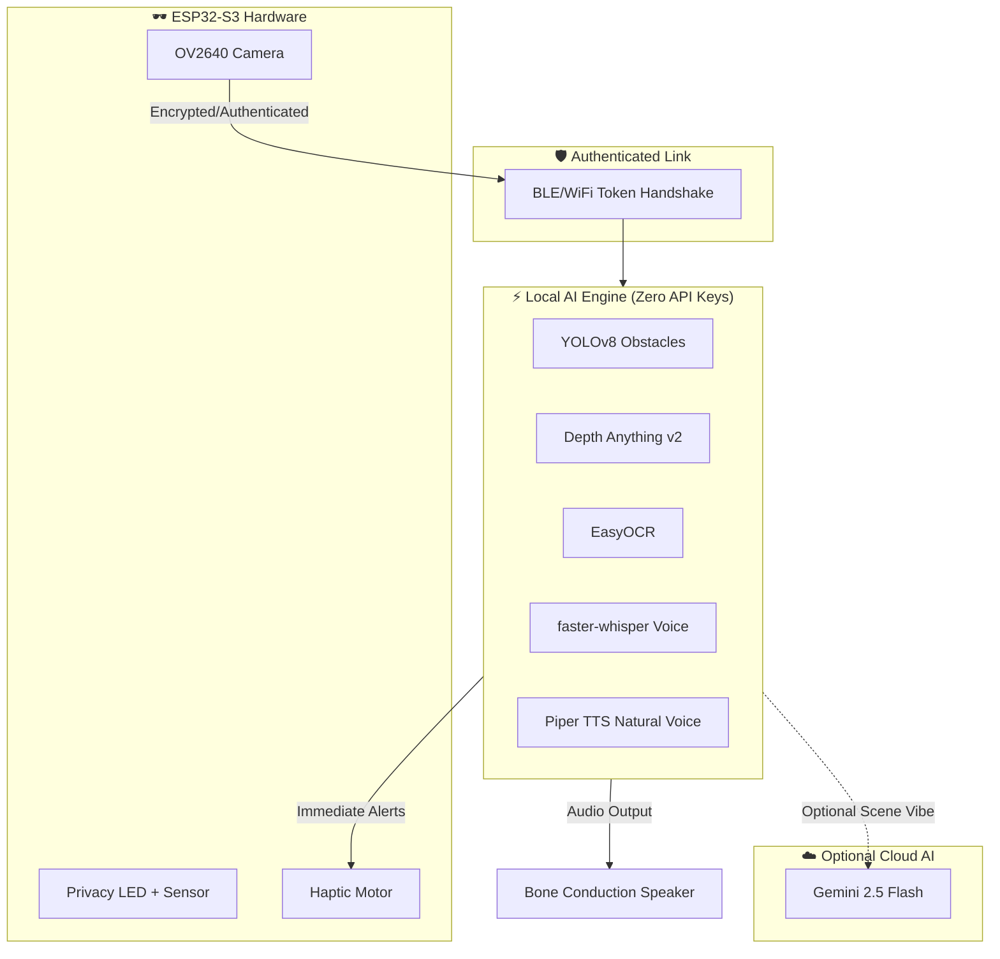

# VisionAid Smart Glasses

> AI-powered, privacy-first smart glasses for the visually impaired.

VisionAid is an open-source, affordable, and AI-powered assistive wearable device designed to help visually impaired individuals perceive and navigate the world safely and independently.

---

## 🛡️ Security, Privacy & Anti-Hacking

For an assistive device, **security is a life-safety requirement**:
- 🔒 **Authenticated Gated Pairing**: The glasses enforce a cryptographic token challenge over BLE and WiFi (`AUTH:<token>`). Unauthenticated devices are kicked within 10 seconds to stop eavesdropping.
- 🛑 **Air-Gapped Safety Precedence**: Local YOLOv8 + Depth Anything obstacle alerts have absolute execution priority and **cannot be remotely muted or overridden** by network attacks.
- 🔐 **AES-256-GCM Storage Encryption**: The face recognition database and all captured photos/videos are encrypted at rest with authenticated AES-256-GCM.
- 🚨 **Hardware Privacy LED Interlock**: Circuit-level MOSFET power interlock ensures the camera cannot capture images without illuminating the privacy indicator LED.
- 🛡️ **ESP32-S3 Secure Boot & Flash Encryption**: Hardware eFuse security prevents firmware extraction or tampering.

See full security specification in [`docs/security_and_privacy.md`](docs/security_and_privacy.md).

---

## 🔑 Do You Need API Keys to Run This?

### **NO! The core product works 100% offline with ZERO API keys.**

Thanks to our hybrid open-source architecture, you do **not** need an internet connection or any API keys for daily use:
- 🚨 **Obstacle Detection**: YOLOv8 (Offline, 0 API keys)
- 📏 **Distance & Depth**: Depth Anything v2 (Offline, 0 API keys)
- 📖 **Text & Sign Reading**: EasyOCR (Offline, 0 API keys)
- 🫂 **Face Recognition**: Local embeddings (Offline, 0 API keys)
- 🎤 **Voice Commands**: faster-whisper (Offline, 0 API keys)
- 🗣️ **Natural Speech**: Piper TTS (Offline, 0 API keys)

*Optional*: You only need a free Gemini API key if you want extended conversational scene narratives (e.g., *"Describe the room's vibe and decor"*).

---

## 🚀 Features

- 👁️ **Instant Obstacle Alerts**: Real-time (~20ms) detection of cars, people, stairs, curbs, and drop-offs.
- 📖 **Text & Sign Reading (OCR)**: Reads street signs, packages, menus, and receipts.
- 🫂 **Private Face Recognition**: Identifies enrolled friends and family locally.
- 📳 **Haptic Feedback**: Immediate directional vibration cues for close-range hazards.
- 🦴 **Bone Conduction Audio**: Delivers audio guidance while keeping ear canals unobstructed.
- 🔋 **Smart Power Modes**: Automatically transitions into deep sleep when idle.

---

## 🛠️ Architecture



---

## 📋 Hardware Requirements (BOM)

| Component | Description | Est. Cost (INR) |
|---|---|---|
| Seeed XIAO ESP32S3 Sense | Main MCU with OV2640 camera & PSRAM | ₹1,850 |
| Bone conduction transducer (8Ω, 1W) | Ear-canal-open acoustic output | ₹599 |
| MAX98306 audio amplifier | Audio drive circuit | ₹150 |
| Vibration motor (10mm coin) | Direct haptic proximity warnings | ₹60 |
| LiPo battery 150mAh | Internal battery | ₹125 |
| Dual MOSFETs | Privacy LED hardware power interlock | ₹20 |
| Ambient Light Sensor | Anti-tamper optical sensor | ₹80 |
| 3D Printed Frame (PETG) + Hinges | Wearable structural frame | ~₹1,350 |
| **Total Prototype Cost** | | **~₹4,234** |

---

## ⚡ Quick Start

```bash
# 1. Clone & Enter Server directory
cd server/
cp .env.example .env

# 2. Setup Python environment
python3 -m venv .venv && source .venv/bin/activate
pip install -r requirements.txt

# 3. Test with Laptop Webcam (Offline Mode, Zero API Keys!)
python main.py --mode webcam --offline

# 4. Or run with Glasses over Bluetooth
python main.py --mode ble
```

---

## 🎮 Controls

### Button Controls (ESP32)
| Input | Action |
|---|---|
| **Single Press** | Scan scene and narrate |
| **Double Press** | Read text (OCR) |
| **Triple Press** | Identify known faces |
| **Long Press** | Toggle video recording |

### Voice Commands (faster-whisper)
| Spoken Phrase | Action |
|---|---|
| *"Describe what you see"* | Describes surroundings |
| *"Read text"* | Reads signs or documents |
| *"Who is this?"* | Identifies person in view |
| *"Navigate"* | Toggles active navigation mode |
| *"Take photo"* | Encrypts & saves photo |
| *"Record video"* | Starts encrypted video capture |

---

## 📱 Mobile Companion App (`mobile/`)

VisionAid includes a production-ready, cross-platform **Flutter Companion App** engineered specifically for visually impaired users:
- 📱 **Zero-Touch In-Pocket Operation**: The app runs silently in the background while the phone is in your pocket or bag; all actions trigger via the glasses or voice commands.
- 🖐️ **Tactile 4-Quadrant Dashboard**: High-contrast, non-visual muscle-memory interface (Top-Left: *Describe*, Top-Right: *Read Text*, Bottom-Left: *Who Is Here?*, Bottom-Right: *Lost Item*).
- 👁️‍🗨️ **WCAG AAA High Contrast**: Pure OLED black (`#000000`) with intense tactile yellow (`#FFD700`) exceeding 15:1 optical contrast ratio.
- 🗣️ **TalkBack & VoiceOver Integration**: First-class `Semantics` tags, >=64dp touch targets, and physical haptic feedback.
- 🫂 **Face Enrollment Directory**: Manage and label profiles for family, friends, and caregivers.
- 🆘 **Emergency SOS**: Single or triple-click rapid location and alert dispatch.

See [`mobile/README.md`](mobile/README.md) for mobile app build and setup instructions.

---

## 🧠 Cognitive Intelligence & Training (`training/`)

- 🧠 **Episodic Visual Memory**: 45-minute rolling memory answering *"Where did I drop my keys?"* or *"Did I leave the stove on?"*.
- 📐 **Ground-Plane Drop Scanner**: Detects small dropped items (cards, keys, coins) on the floor and gives clock-direction guidance.
- 🚪 **Door & Affordance Reasoning**: Determines push/pull door types, handle positions, and empty vs. occupied chairs.
- 🐕 **Virtual Guide Dog Pathfinding**: Dynamic corridor navigation guiding users through free-space corridors.
- 🎓 **Colab GPU Training Workstation**: 1-click cloud training workstation [`VisionAid_World_Class_GPU_Workstation.ipynb`](training/VisionAid_World_Class_GPU_Workstation.ipynb) for heavy multi-scale training across 5,000+ real-world images and Moondream2 VLM LoRA fine-tuning.
- 📦 **Mega Dataset Ingestion**: [`mega_dataset_curator.py`](training/mega_dataset_curator.py) aggregating urban stairs, sidewalk curbs, street obstacles, and pedestrian traffic signals.

---

## License
MIT License
